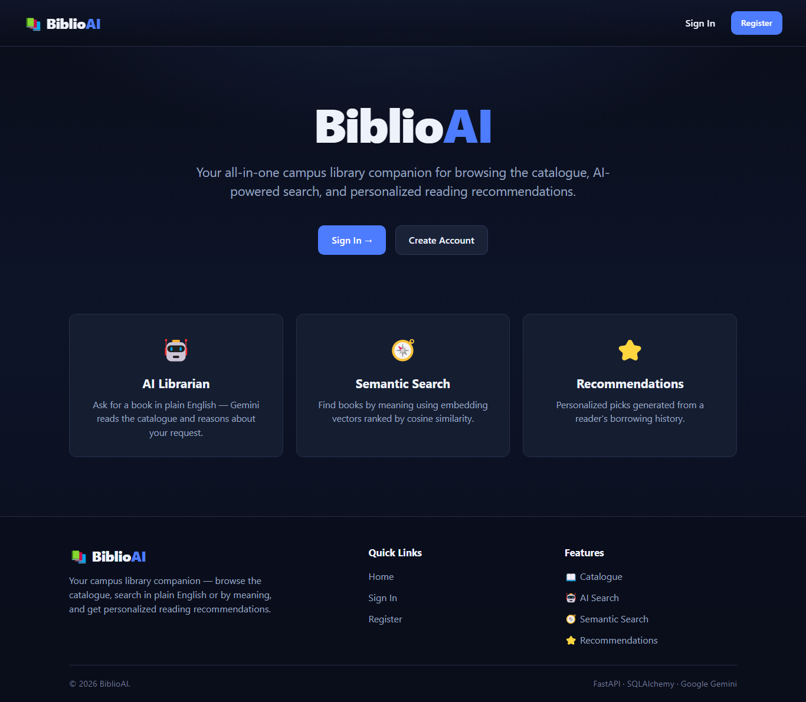
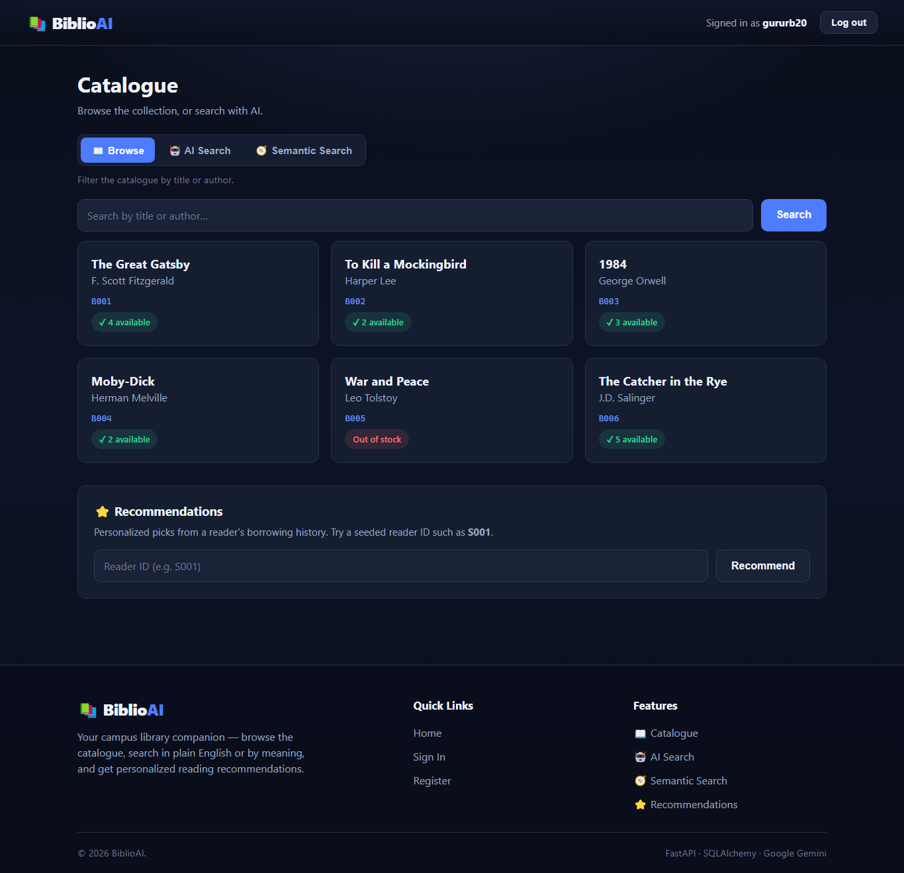
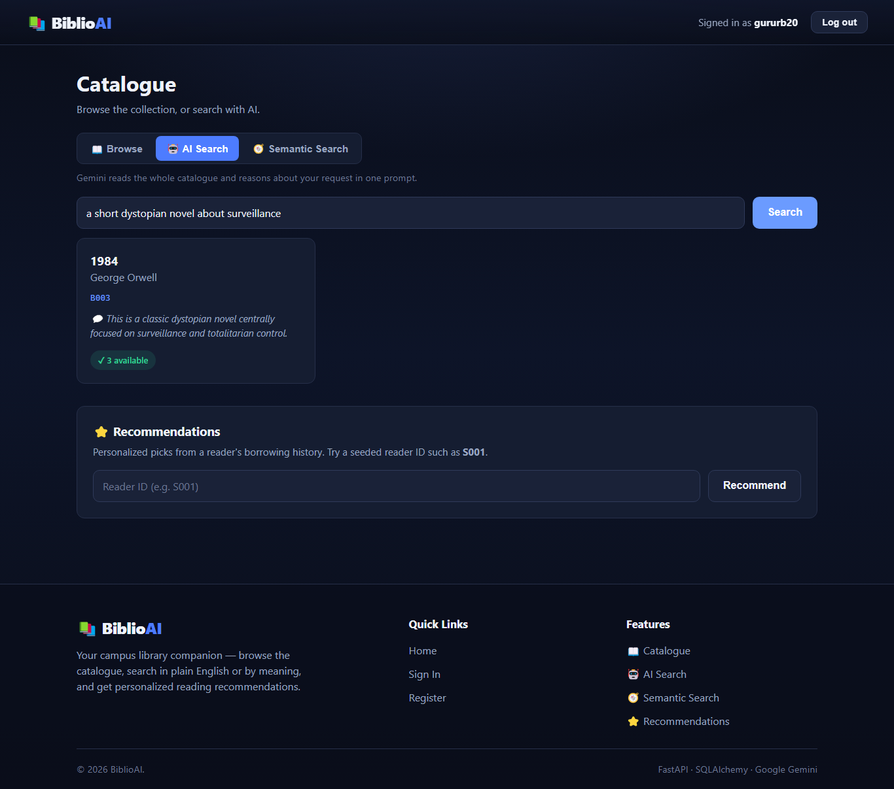
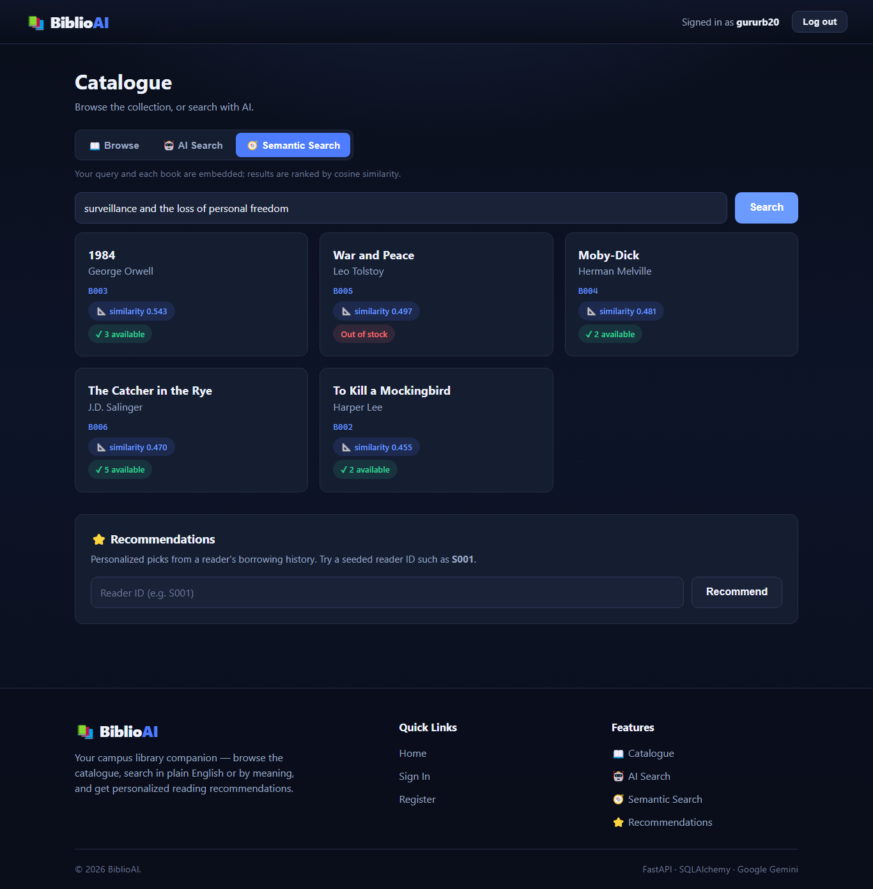
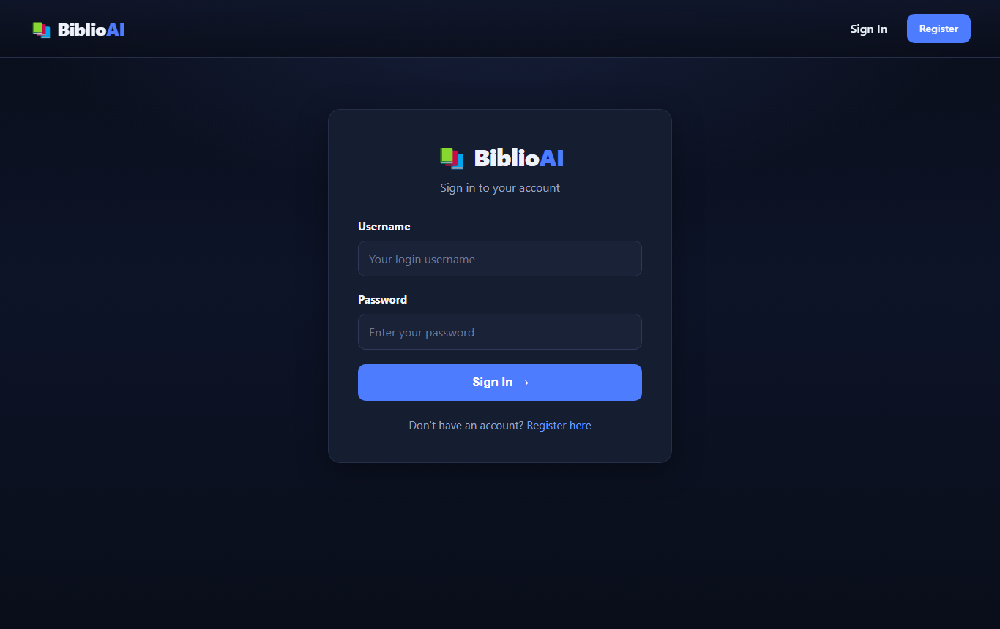
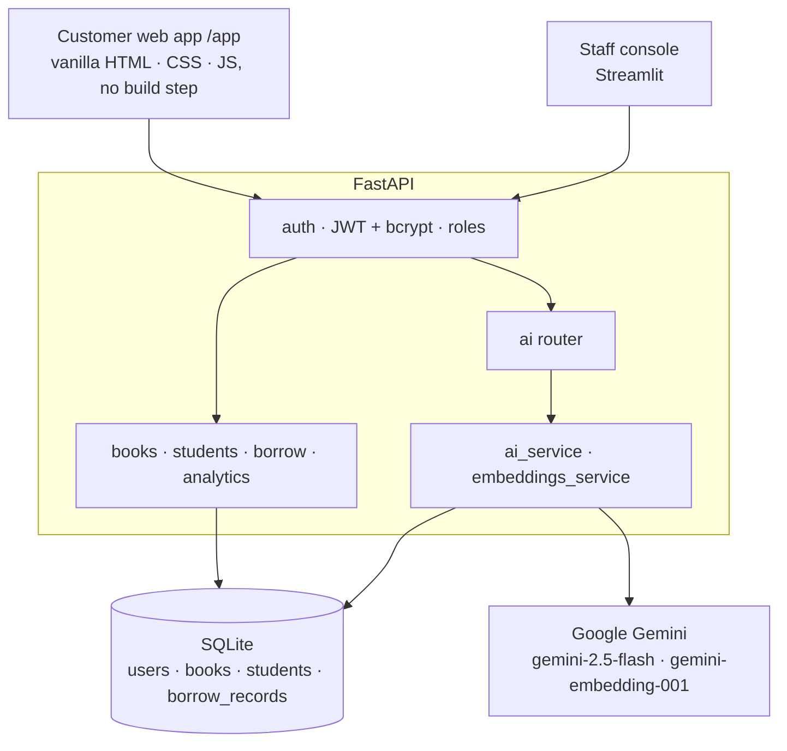
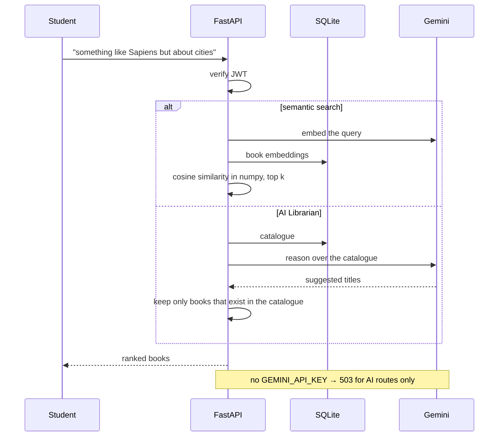

# BiblioAI

**An AI-powered campus library — browse the catalogue, search in plain English or by meaning, and get reading recommendations from your borrowing history.**

[](backend/requirements.txt)
[](backend/app/main.py)
[](backend/app/models.py)
[](streamlit_app/)
[](backend/app/ai_service.py)
[](LICENSE)

BiblioAI began as a single-file Tkinter desktop app and grew into a full-stack
system: a FastAPI + SQLAlchemy REST API with JWT auth and role-based access, a
customer web app served by the same backend, a Streamlit staff console, and an
AI layer on Google Gemini. It runs locally on SQLite by design.



---

## Contents

| Section | |
|---|---|
| [What it does](#what-it-does) | The feature surface, by area |
| [Architecture](#architecture) | Two front ends, one API, one database |
| [How an AI search travels](#how-an-ai-search-travels) | Question in, validated books out |
| [Quick start](#quick-start) | API, web app, staff console |
| [Project status](#project-status) | Where it came from, and the known tradeoffs |
| [Design decisions](#design-decisions) | The tradeoffs, and why |
| [Repository layout](#repository-layout) | Where things live |
| [Documentation](#documentation) | Which file answers which question |
| [Team](#team) | Who built it |

---

## What it does

| Area | Capabilities |
|---|---|
| **AI Librarian** | Ask for a book in plain English; Gemini reasons over the catalogue and returns matches validated against it |
| **Semantic search** | Books and queries are embedded with `gemini-embedding-001` and ranked by cosine similarity in Python — no vector DB |
| **Recommendations** | Personalised picks from a reader's borrowing history |
| **Circulation** | Issue and return with penalty rules |
| **Analytics** | Most-borrowed titles, penalty revenue and loan statistics in the staff console |
| **Auth & roles** | JWT + bcrypt; students read, librarians write |
| **Degradation** | Without an API key, AI endpoints return 503 and everything else keeps working |

| Catalogue dashboard | AI search |
|---|---|
|  |  |
| **Semantic search** | **Sign in** |
|  |  |

---

## Architecture



The same backend serves the customer web app at `/app`, so there is one origin
and one deployable for students.

---

## How an AI search travels



---

## Quick start

```bash
# 1 — API + customer web app
cd backend
python -m venv .venv && .venv\Scripts\activate      # source .venv/bin/activate on macOS/Linux
pip install -r requirements.txt
cp .env.example .env                                # add GEMINI_API_KEY to enable AI (optional)
python -m app.seed_data                             # seed data + the librarian account
python -m app.seed_embeddings                       # backfill embeddings (needs GEMINI_API_KEY)
uvicorn app.main:app --reload
#   web app  → http://localhost:8000/app/
#   API docs → http://localhost:8000/docs

# 2 — staff console (optional)
cd ../streamlit_app
python -m venv .venv && .venv\Scripts\activate
pip install -r requirements.txt
cp .env.example .env                                # API_URL=http://localhost:8000
streamlit run app.py                                # http://localhost:8501
```

The full API surface and environment variables are in
[backend/README.md](backend/README.md).

---

## Project status

Complete for its scope. The original Tkinter + CSV app is kept under
[`legacy/tkinter_app/`](legacy/tkinter_app/) for provenance.

| Deliberate tradeoff | Detail |
|---|---|
| SQLite, single writer | Right for one local user; concurrent writers would need Postgres |
| `create_all`, not migrations | After a model change, delete `library.db` and re-seed |
| JWT in session memory | No hard-refresh survival, in exchange for no `localStorage` token theft |
| Embeddings on create or backfill | An edited book re-embeds with `seed_embeddings.py --force` |
| AI is optional and non-deterministic | 503 without a key; ranking in Python suits a small catalogue |

---

## Design decisions

**Validate what the model returns.** The AI Librarian's suggestions are checked
against the catalogue, so it can only recommend books the library actually has.

**No vector database.** A campus catalogue fits in memory, so embeddings live
beside the books and cosine similarity is a numpy call.

**AI is a layer, not a dependency.** Every AI route can fail with a clear 503;
browsing, circulation and analytics never touch Gemini.

**Roles at the API.** Students get read-only access and librarians get write
access, enforced on the server rather than by hiding buttons.

**No build step for students.** The customer app is plain HTML, CSS and
JavaScript served by FastAPI, so there is nothing to compile or host separately.

> Built for academic and portfolio purposes. Redistributing or presenting this
> project as your own is prohibited.

---

## Repository layout

```
.
├── backend/
│   ├── app/            config, models, schemas, security, routers, ai_service, embeddings_service, seeders
│   └── seed/           seed CSVs
├── frontend_web/       customer web app — index.html · styles.css · app.js
├── streamlit_app/      staff console
├── legacy/tkinter_app/ the original desktop app
└── images/             screenshots
```

---

## Documentation

| Question | File |
|---|---|
| *Which routes and variables does the API have?* | [backend/README.md](backend/README.md) |
| *What did the original app look like?* | [legacy/tkinter_app/](legacy/tkinter_app/) |

---

## Team

| Member | Focus |
|---|---|
| **Guru R Bharadwaj** | API, AI layer, web app, staff console |

---

## License

[MIT](LICENSE).
